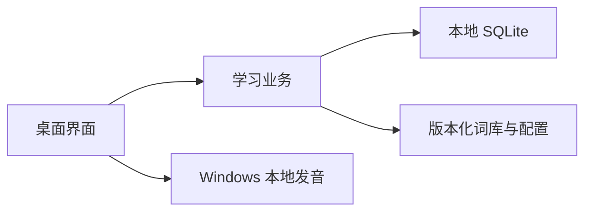

# 架构与数据

`ui.py` 负责独立场景和首次引导，`animations.py` 负责动画。`core.py` 保存学习规则、目标计算和结算，`assessment.py` 保存测评选题与估计规则，两者独立于 Qt。`storage.py` 提供 SQLite 持久化。`speech.py` 仅选择 Windows SAPI 本地引擎。首版没有 Web 服务、云同步、账号或模型请求。

用户档案、学习会话、每次作答、掌握词集合、错题、目标快照、成就获得记录和待学队列通过稳定 ID 关联。会话保存当时的完整词条和题目快照；之后修改词库不会改变旧轮次。目标保存自己的词集版本和分母。

SQLite schema v1 使用 `records(kind, id, data)` 复合主键存放各类 JSON 记录。类型分别为 profile、settings、session、assessment、mastered、goal、earned、queue、event。这样只需一个清楚的存储入口，业务层统一验证数据，不让界面拼接 SQL。兼容旧 schema 升级前保存备份，未知旧结构拒绝修改。

测评与学习会话分开。测评保存题库、等级配置和算法版本、实际题目与选项、每次作答、完成状态及参考结果，不给已掌握集合或学习成就加分。首次引导步骤保存在档案中；最后创建目标与完成引导在同一事务内提交。旧版已完成引导的档案继续进入主页，未完学习保留；重新测评需用户明确采用推荐难度，不重设旧目标基线。

整轮完成、净新增去重、目标更新和成就获得在同一 SQLite 事务中提交。重复完成同一个会话不会再次增加计数。重做历史轮创建新的练习记录，保留词表与原始题目，不增加唯一词数或练习成就。

默认个人数据目录为 `%LOCALAPPDATA%\VocabularyLearning`，不在安装目录。内容资源放在 `vocabulary_app/resources`。`--data-dir` 可为演示或验证指定独立档案，避免混入真实学习记录。同一档案只允许一个应用实例。

导出是带 schemaVersion 的 JSON；导入先验证格式、引用与状态，再备份当前数据并替换。首版不保存任何服务商凭据。不要用编辑 JSON 的方式修改结算数据；需要纠正学习规则时修改业务层并运行测试。

未来阅读、写作、评测、AI 与网页端复用稳定词条、会话事件、规则及内容格式；网页界面和浏览器存储另行实现。

