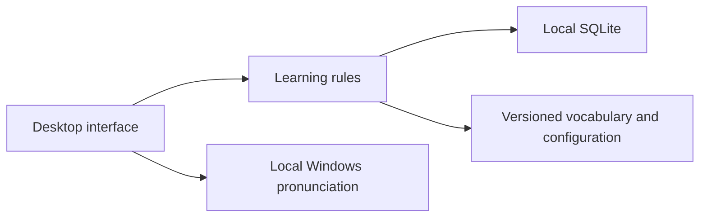

# Architecture and data

`ui.py` handles separate scenes and first-use onboarding; `animations.py` handles animation. `core.py` owns learning rules, goal calculations, and completion accounting. `assessment.py` owns question selection and estimation rules. Both are independent of Qt. `storage.py` provides SQLite persistence. `speech.py` selects only the local Windows SAPI engine. The initial release has no web service, cloud synchronization, accounts, or model requests.

Stable IDs link profiles, learning sessions, individual answers, the mastered word set, mistakes, goal snapshots, earned achievements, and the study queue. Sessions save complete word and question snapshots from their creation time, so later catalog edits do not change old sessions. Each goal saves its own word set version and denominator.

The English catalog is versioned `content-0.2.1-en`. Legacy stock text is translated for presentation through exact text mappings; original saved definitions, answer choices, responses, and scoring evidence remain intact. Personal names and user-written text are preserved. Legacy self-rating labels and language metadata are normalized for the English interface. When an older interface text file contains a complete copy of the former defaults, stock values adopt the English defaults while personal edits remain unchanged.

SQLite schema v1 stores JSON records under the composite primary key `records(kind, id, data)`. Record kinds are profile, settings, session, assessment, mastered, goal, earned, queue, and event. A single storage entry point keeps business validation consistent and prevents the interface from assembling SQL. Compatible older schemas are backed up before migration; unknown legacy structures are rejected without modification.

Assessments are separate from learning sessions. An assessment saves the question bank, level configuration and algorithm versions, actual questions and options, individual answers, completion status, and reference result. It adds nothing to mastered words or learning achievements. Onboarding steps are saved in the profile. Creating the final goal and completing onboarding commit in one transaction. Previously onboarded profiles continue to the home page with unfinished learning preserved. Adopting a reassessment's recommended difficulty requires an explicit choice and does not reset existing goal baselines.

Session completion, deduplication of net new words, goal updates, and achievement awards commit in one SQLite transaction. Completing the same session again does not add counts. Replaying a historical session creates a new practice record, keeps the word list and original questions, and does not add unique words or practice achievements.

The default personal data directory is `%LOCALAPPDATA%\VocabularyLearning`, outside the installation directory. Content resources live in `vocabulary_app/resources`. `--data-dir` selects a separate profile for demos or verification without changing real study records. Only one application instance may use a profile at a time.

Exports are JSON with a schemaVersion. Import validates format, references, and state, then backs up and replaces current data. The initial release stores no provider credentials. Do not edit completion data directly in JSON; correct learning rules in the business layer and run the tests.

Future reading, writing, assessment, AI, and web modules can reuse stable word IDs, session events, rules, and content formats. A web interface and browser storage will be implemented separately.
